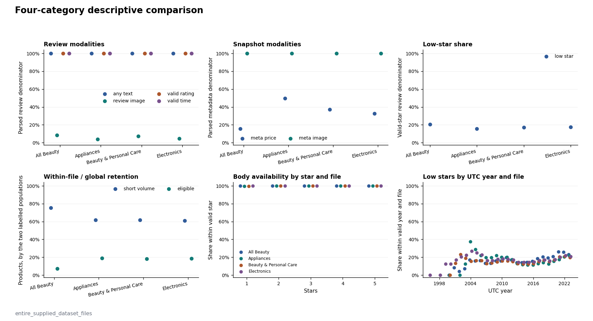
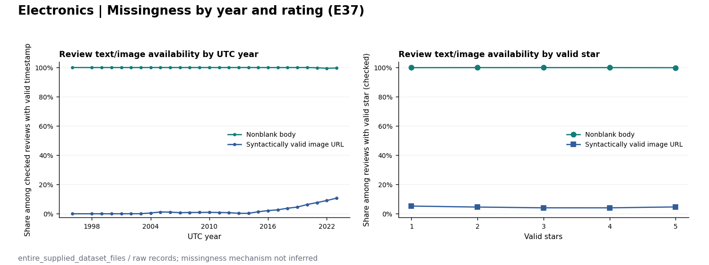
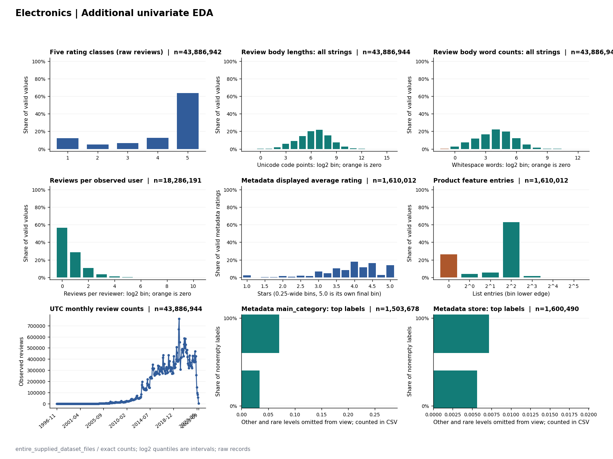
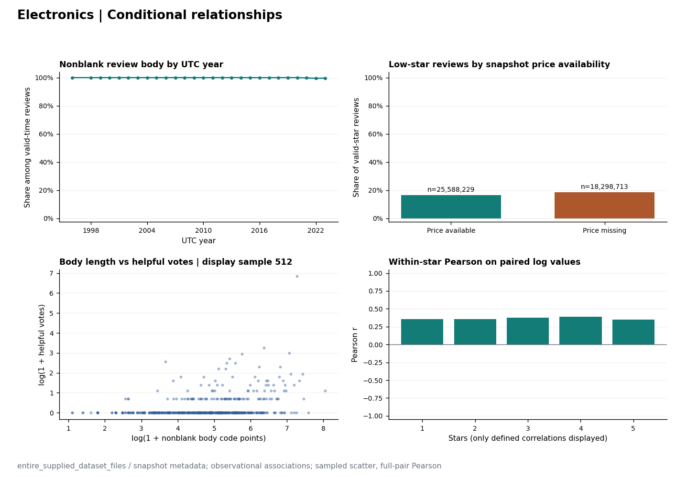
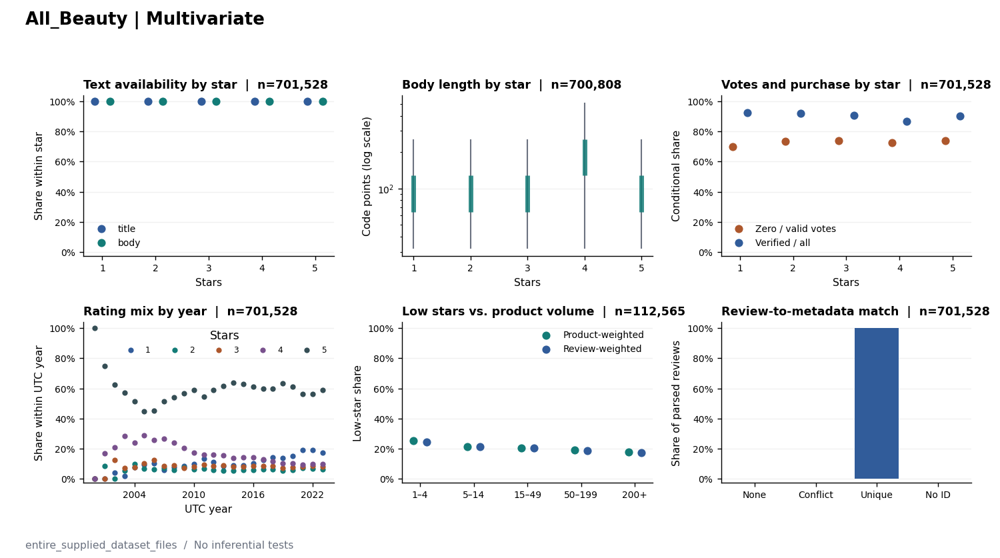
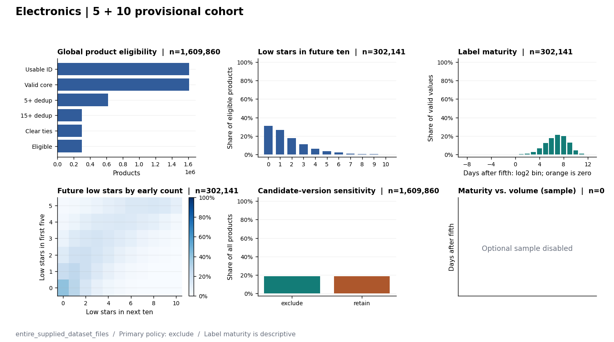
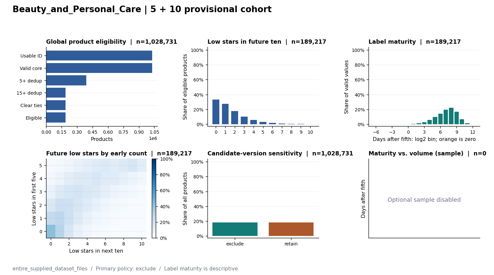

دانشگاه صنعتی شریف | درس تحلیل داده | پاییز ۱۴۰۵

<h1>شناخت داده و تحلیل اکتشافی نقدهای محصولات آمازون</h1>
<h2>ارزیابی امکان استفاده از متن نقدهای اولیه برای پیش‌بینی سهم نقدهای منفی آینده</h2>

گزارش فاز اول پروژهٔ مسیر ب — مجموعه‌دادهٔ Amazon Reviews’23

نیما ادیبی معتمد

آبان ۱۴۰۵

# چکیده

این پژوهش امکان استفاده از اطلاعات موجود پس از ثبت پنج نقد معتبر نخستِ مشاهده‌شدهٔ هر محصول برای پیش‌بینی سهم نقدهای یک‌ و دو‌ستاره در ده نقد معتبر بعدی را بررسی می‌کند. پرسش محوری آن است که آیا متن نقدهای اولیه اطلاعاتی افزون بر امتیازهای همان نقدها دارد و آیا این ارزش افزوده میان دسته‌های محصول متفاوت است. فاز نخست به شناخت منبع، ساختار، کیفیت و توزیع‌های داده و ارزیابی امکان ساخت جامعهٔ محصولی اختصاص یافته است؛ آموزش و مقایسهٔ مدل‌های پیش‌بینی در این فاز انجام نمی‌شود.

چهار دستهٔ `All_Beauty`، `Appliances`، `Beauty_and_Personal_Care` و `Electronics` از دادهٔ Amazon Reviews’23 انتخاب شده‌اند. بررسی کامل هشت فایل فشرده، **70,628,467 رکورد نقد** و **2,845,843 رکورد فراداده** را پوشش می‌دهد. از این مجموعه، **2,845,475 محصول والد یکتا** در فایل‌های نقد شناسایی شد. پس از اعمال قواعد امتیاز و زمان معتبر، حذف کپی‌های دقیق، حداقل پانزده نقد و حذف موارد مبهم مرزی و نسخه‌ای، **517,606 محصول** به‌طور موقت برای مطالعهٔ اصلی واجدشرایط‌اند (حدود **18.19٪** از محصولات مشاهده‌شده). در ممیزی نقدهای معتبر، سهم امتیازهای یک و دو در چهار دسته بین **15.51٪** و **20.69٪** است.

تمامیت خروجی تحلیل اکتشافی با مرجع ممیزی کیفیت تطبیق داده شد. بااین‌حال، تفاوت توصیفی توزیع‌ها، رابطهٔ هم‌بستگی و وجود جامعهٔ محصولی برای نتیجه‌گیری دربارهٔ ارزش افزودهٔ پیش‌بینانهٔ متن یا رابطهٔ علّی کافی نیست. یافته‌ها مبنای تعیین سیاست پاک‌سازی، تقسیم بدون نشت و مقایسهٔ منصفانه در فازهای بعدی‌اند.

**کلیدواژه‌ها:** نقد کاربران، تحلیل اکتشافی، کیفیت داده، متن، امتیاز، دادهٔ زمانی، نشت اطلاعات، تحلیل چندوجهی.

# ۱. مسئله و منطق انتخاب سؤال

## ۱.۱. مسئلهٔ کاربردی

فراوانی محصولات و نقدهای کاربران، بررسی دستی تمام بازخوردها را پرهزینه می‌کند. پس از مشاهدهٔ تعداد محدودی نقد، یک سامانهٔ پشتیبان تصمیم می‌تواند محصولاتی را برای بازبینی انسانی اولویت‌بندی کند که احتمال می‌رود در نقدهای بعدی سهم بیشتری از امتیازهای پایین داشته باشند. چنین ابزاری جایگزین بررسی کارشناسی یا داوری قطعی دربارهٔ کیفیت محصول نیست؛ هدف آن ارائهٔ یک شاخص اولویت‌بندیِ قابل‌ارزیابی است.

امتیاز عددی خلاصه‌ای فشرده از تجربهٔ نویسندهٔ نقد است؛ متن ممکن است نوع مشکل، شدت نارضایتی و جزئیاتی را منعکس کند که تنها از امتیاز به دست نمی‌آید. این احتمال، فرضیهٔ پژوهش است و نمی‌توان آن را صرفاً از وجود متن یا هم‌بستگی‌های توصیفی نتیجه گرفت.

## ۱.۲. پرسش‌های نامزد و دلیل انتخاب

سه پرسش در آغاز بررسی شدند: (۱) آیا افزودن متن پنج نقد اولیه به اطلاعات امتیازهای همان نقدها، پیش‌بینی سهم نقدهای کم‌ستارهٔ بعدی را بهبود می‌دهد؟ (۲) آیا الگوی امتیازهای ابتدایی می‌تواند میانگین امتیاز ده نقد آینده را پیش‌بینی کند؟ (۳) طول متن، زمان ثبت، امتیاز و رأی مفید چه ارتباط‌های مشاهده‌ای دارند؟

پرسش نخست انتخاب شد، زیرا زمان تصمیم و هدف آن روشن است، مقایسهٔ دو منبع متفاوت اطلاعاتی را ممکن می‌کند و با اولویت‌بندی بازبینی انسانی ارتباط مستقیم‌تری دارد. پرسش دوم اگرچه اجرایی است، ممکن است با خلاصه‌کردن توزیع در میانگین، سهم بازخوردهای شدیداً منفی را پنهان کند. پرسش سوم برای شناخت داده مفید است، اما رأی مفید به زمان مواجهه و عوامل دیده‌نشدۀ دیگری وابسته است و به‌تنهایی مسئلهٔ پیش‌بینی نارضایتی محصول را تعریف نمی‌کند.

## ۱.۳. سؤال نهایی و ادعای قابل‌آزمون

**آیا ویژگی‌های متنی پنج نقد معتبرِ مشاهده‌شدهٔ نخست، علاوه بر امتیازهای همان نقدها، خطای پیش‌بینی سهم نقدهای یک و دو ستاره در ده نقد معتبر بعدی محصول را کاهش می‌دهند؟ این تفاوت در چهار دستهٔ محصول چه اندازه است؟**

واحد اصلی مطالعه محصول والد، و زمان تصمیم بلافاصله پس از نقد پنجم است. ارزش افزودهٔ متن فقط وقتی قابل‌ادعاست که روش عددی و روش ترکیبی روی نمونه‌های یکسان، با قواعد پردازش و بودجهٔ تنظیم قابل‌مقایسه، خارج از نمونه ارزیابی شوند.

# ۲. منشأ داده و دامنهٔ مشاهده

منبع پژوهش مجموعه‌دادهٔ **Amazon Reviews’23** منتشرشده توسط گروه پژوهشی مک‌آولی در دانشگاه کالیفرنیا، سن‌دیگو است. نشانی رسمی مجموعه‌داده در بخش منابع آمده است. مطالعه از چهار زیرمجموعهٔ موضوعی و برای هر زیرمجموعه از دو فایل نقد و فرادادهٔ محصول استفاده می‌کند. فایل‌ها با قالب `JSONL` فشرده‌شده نگهداری شده‌اند؛ هر خطِ پذیرفته‌شده یک شیء مجزای داده را نشان می‌دهد.

این داده‌ها مشاهده‌ای‌اند. نویسندگان نقد، نمونهٔ تصادفی از تمامی خریداران نیستند؛ حتی در میان خریداران، احتمال نوشتن نقد و احتمال دیده‌شدن آن ممکن است با رضایت، زمان، محصول یا فرایند گردآوری وابسته باشد. منظور از «نقد اولیه» نیز اولین نقد معتبر **در فایل‌های انتخاب‌شده و مشاهده‌شده** است، نه لزوماً نخستین نقد واقعی در کل تاریخ سامانه. همچنین زمان نقد را نباید با زمان خرید یا زمان خواندن نقد یکسان دانست.

چهار دسته بر اساس عضویت در فایل‌های منبع تعریف می‌شوند. مقدار فیلدهای داخلی فراداده الزاماً معادل برچسب موضوعی فایل نیست. فاز نخست تمام فایل‌های تأمین‌شده را پوشش داده است، اما نتیجه صرفاً به همین دامنهٔ ثبت‌شده تعمیم داده می‌شود؛ هیچ ادعایی دربارهٔ کل نقدهای آمازون یا همهٔ محصولات و خریداران مطرح نمی‌شود.

ویژگی‌های تجمیعی فراداده، از جمله میانگین امتیاز و شمار امتیازهای ثبت‌شده در زمان جمع‌آوری، ممکن است از نقدهای بعد از زمان پیش‌بینی تأثیر گرفته باشند. قیمت و ارجاع تصویر فراداده نیز بدون سابقهٔ زمانی، ویژگی تاریخیِ تأییدشده در لحظهٔ پنجمین نقد محسوب نمی‌شوند.

# ۳. ساختار داده و واحدهای تحلیل

## ۳.۱. رکورد، محصول و اتصال

در فایل نقد، متغیرهایی مانند شناسهٔ محصول، امتیاز، عنوان، بدنهٔ متن، زمان ثبت، رأی مفید، وضعیت خرید تأییدشده و ارجاع تصویر بررسی می‌شوند. در فایل فراداده، مشخصاتی مانند عنوان کالا، مسیر دسته‌بندی، ویژگی‌ها، توضیحات، قیمت، تصویر، میانگین امتیاز و شمار امتیازها وجود دارند. بعضی فیلدها ساختار تو‌در‌تو دارند و وجود یک کلید لزوماً به معنی مقدار معتبر یا ناتهی نیست.

شناسهٔ `parent_asin` برای اتصال نقدها به محصول والد به کار می‌رود و `asin` گونهٔ محصول را مشخص می‌کند. از نظر آماری، رکورد خامِ نقد، محصول یکتا، ردیف فراداده و نمونهٔ محصولی واجدشرایط، چهار واحد متفاوت‌اند. تکرار شناسهٔ محصول در نقدهای متعدد طبیعی است و با کپی دقیق یک رکورد یکسان نیست. اتصال به فراداده تنها هنگامی «یکتا» محسوب می‌شود که پس از بررسی نسخه‌ها، یک نسخهٔ کانونی معتبر برای همان شناسه وجود داشته باشد.

## ۳.۲. حجم فایل‌ها و اعتبار رکوردها

| دسته | نقد خام | فراداده | کپی دقیق اضافی نقد | امتیاز نامعتبر |
| --- | --- | --- | --- | --- |
| `All_Beauty` | 701,528 | 112,590 | 7,275 | 0 |
| `Appliances` | 2,128,605 | 94,327 | 22,656 | 0 |
| `Beauty_and_Personal_Care` | 23,911,390 | 1,028,914 | 242,473 | 0 |
| `Electronics` | 43,886,944 | 1,610,012 | 477,968 | 2 |
| **مجموع** | 70,628,467 | 2,845,843 | 750,372 | 2 |

*جدول ۱.* حجم داده‌ها در اجرای کامل. کپی‌های اضافی نقد بر اساس تکرار دقیق در فایل‌های منبع شمارش شده‌اند؛ شمار رکورد خام و شمار نمونهٔ پیش‌بینی یکسان نیستند.

محصولات والد دارای شناسهٔ معتبر در فایل‌های نقد در مجموع **2,845,475 مورد یکتا** بودند. در چهار فایل بررسی‌شده، محصول والد مشترک بین دو دسته در خروجی این اجرا شناسایی نشد. این یافته دربارهٔ همان چهار فایل و شناسه‌های مشاهده‌شده است، نه تضمین عدم هم‌پوشانی در زیرمجموعه‌های دیگر.

## ۳.۳. ممیزی مستقل اسکیمای فایل‌ها و ارتباط محصولات

ممیزی ساختار در اجرای مستقل `20261101T045111Z_23f309f5` هر هشت فایل ورودی را به‌صورت کامل تا انتهای فایل اسکن کرد. وضعیت اجرا `completed` و دامنهٔ آن `entire_supplied_dataset_files` ثبت شده است. در هیچ‌یک از هشت فایل، خط خالی، خطای خواندن JSON یا رکورد غیرشیء گزارش نشد. مجموع شمار رکوردهای مستقل با نتایج کیفیت و تحلیل اکتشافی سازگار است.

| دسته | فیلدهای سطح اول نقد (اجتماع) | فیلدهای سطح اول فراداده (اجتماع) | شناسهٔ محصولِ دارای نقد | محصول فقط در فراداده |
|---|---:|---:|---:|---:|
| `All_Beauty` | 10 | 14 | 112,565 | 25 |
| `Appliances` | 10 | 16 | 94,319 | 8 |
| `Beauty_and_Personal_Care` | 10 | 16 | 1,028,731 | 183 |
| `Electronics` | 10 | 16 | 1,609,860 | 152 |
| **جمع ردیف‌های دسته‌ای** | — | — | **2,845,475** | **368** |

تعداد فیلدهای هر ستونِ جدول، **اجتماع نام فیلدهای مشاهده‌شده در تمام رکوردهای همان فایل** است و لزوماً شمار فیلدهای یک رکورد منفرد نیست. وجود فیلد نیز به معنی معتبر یا ناتهی بودن مقدار آن نیست؛ نوع‌های واقعی، اعضای ساختارهای تودرتو و نرخ حضور هر فیلد در جدول‌های اختصاصی هر دسته ثبت شده‌اند.

برای اتصال نقد به فراداده، تساوی دقیق رشتهٔ `parent_asin` بدون نرمال‌سازی به کار رفته است. در هر چهار دسته، تمام رکوردهای نقد با شناسهٔ والدِ قابل‌استفاده به یک رکورد فراداده با شناسهٔ یکتا متصل شدند و **هیچ نقدِ فاقد اتصال فراداده** گزارش نشد. در مقابل، ۳۶۸ رکورد فراداده به شناسه‌های محصولی تعلق داشتند که نقدی در فایل متناظر نداشتند. بنابراین «پوشش کامل اتصال نقدها» معادل وجود نقد برای تمام ردیف‌های فراداده نیست.

منشأ این یافته‌ها فایل‌های `RUN_STATUS.json`، `datasets_manifest.json` و `summary.json` اجرای مستقل ساختار است. جدول‌های فیلد و روابط، موجودی ساختارهای تودرتو، وضعیت زمانی و دسترس‌پذیری وجوه در `reports/phase1/structure/` نگهداری می‌شوند.

## ۳.۴. زمان و ارزیابی سازگاری ساختار

زمان نقد بر اساس مقادیر ثبت‌شده و با هماهنگ‌سازی به UTC تحلیل شده است. ممیزی مستقل ساختار، دامنهٔ زمانیِ مشاهده‌شده، قابلیت تبدیل زمان، تساوی‌های زمانی و تمایز شناسه‌های سطح نقد و محصول را به تفکیک دسته در `temporal_variables.csv`، `temporal_ties.csv` و `relationships.csv` مستند می‌کند. کنترل‌های تکمیلی کیفیت و وضعیت نوع و گمشدگی هر فیلد در خروجی‌های `q02_field_missingness.csv`، `q07_review_type_compatibility.csv`، `q08_metadata_type_compatibility.csv` و `univariate_field_states.csv` قابل پیگیری است. زمان نقد، زمان خرید یا زمان جمع‌آوری فراداده نیست.

# ۴. ممیزی کیفیت و تصمیم‌های اولیه

## ۴.۱. تمامیت خواندن و اعتبار امتیاز

ممیزی کیفیت، هشت فایل را به‌طور کامل تا پایان فایل بررسی کرده و شمار رکوردها با شمارش اجرای مستقل تحلیل اکتشافی تطبیق داده شده است. در مجموع تنها **۲ نقد دارای امتیاز نامعتبر** در فایل `Electronics` گزارش شد. این دو رکورد در شمارش خام حضور دارند، ولی وارد توالی نقدهای معتبرِ مسئلهٔ اصلی نمی‌شوند. ناسازگاری‌های نوع، مقدار نامعتبر، مقدار گمشده و وضعیت قابل‌استفاده‌بودن هر فیلد به‌صورت جداگانه نگهداری شده‌اند.

## ۴.۲. تکرار دقیق و حذف محافظه‌کارانه

در چهار فایل نقد **750,372 کپی کاملِ اضافه** ثبت شد. این شمارش درون هر فایل انجام شده است. تحلیل اکتشافی نیز پس از کنترل اعتبار هستهٔ زمان و امتیاز، از **70,628,465 رکورد معتبر پیش از حذف کپی** به **69,878,093 نقد متمایز** رسید. در این دادهٔ خاص اختلاف دو شمارش معادل **750,372** نسخهٔ اضافه است؛ این برابری نباید برای داده‌های دیگر مفروض گرفته شود.

حذف فقط برای کپی دقیق تعریف شده است؛ نقدهای دارای متن مشابه یا شناسهٔ کاربر یکسان بدون شواهد کافی خودکار حذف نمی‌شوند. اختلاف نسخه‌های محتمل در سطح رویداد نقد جداگانه کنترل می‌شود. ورودی خام تغییر نکرده و دادهٔ مشتق‌شده با قاعدهٔ بازتولیدپذیر ساخته می‌شود.

## ۴.۳. مقادیر غیرمعمول و گمشدگی

ممیزی میان مقدار گمشده، مقدار تهی، رشتهٔ سفید، نوع نادرست، مقدار نامعتبر و مقدار پرت تفاوت می‌گذارد. در این فاز هیچ قاعدهٔ یکسانی برای حذف همهٔ پرت‌ها یا پرکردن تمام مقادیر گمشده اعمال نشده است. به‌ویژه مقادیر بسیار بزرگ شمار رأی مفید یا طول متن می‌توانند واقعی یا ناشی از خطای ثبت باشند و به بررسی مشروط نیاز دارند. جدول‌های صدک دقیق و شمار پرت بر اساس قاعدهٔ چارکی برای متغیرهای عددی در فایل‌های `E26_E27_EXACT_NUMERIC.csv` ذخیره شده‌اند؛ علامت پرت در این جدول معادل تشخیص خطای داده نیست.

شمارش‌ها و نرخ‌های این فصل عمدتاً روی رکوردهای خام یا هستهٔ معتبر تعریف شده‌اند. هر تغییر جامعهٔ تحلیل باید با صورت و مخرج تازه گزارش شود، نه با انتقال مستقیم درصدها از یک واحد به واحد دیگر.

# ۵. ممیزی وجوه اطلاعاتی و دسترس‌پذیری

دادهٔ مورد بررسی چند وجه اطلاعاتی دارد: متن، امتیاز، زمان، نشانه‌های تعامل با نقد، مشخصات محصول و ارجاع تصویر. برای ارزیابی امکان مقایسهٔ وجه متنی با وجه عددی، وجود مؤثر متن و مقدار معتبر امتیاز اهمیت مستقیم دارد؛ برای شناخت دامنهٔ سوگیری و قابلیت تعمیم، وضعیت سایر وجوه نیز تحلیل می‌شود.

| دسته | بدنهٔ نقد ناتهی | ارجاع تصویر نقد | قیمت معتبر فراداده | ارجاع تصویر فراداده |
| --- | --- | --- | --- | --- |
| `All_Beauty` | 99.90٪ | 8.51٪ | 15.72٪ | 100.00٪ |
| `Appliances` | 99.90٪ | 3.99٪ | 49.54٪ | 100.00٪ |
| `Beauty_and_Personal_Care` | 99.85٪ | 7.10٪ | 36.99٪ | 99.99٪ |
| `Electronics` | 99.91٪ | 4.61٪ | 32.70٪ | 99.98٪ |

*جدول ۲.* سهم دسترس‌پذیری وجوه اطلاعاتی. مخرج متن و تصویر نقد، تمام رکوردهای نقد آن دسته است؛ مخرج قیمت و تصویر فراداده، تمام رکوردهای فرادادهٔ همان دسته است. «ارجاع تصویر» به معنی بازیابی و تفسیر خود تصویر نیست.

*شکل ۱.* مقایسهٔ توصیفیِ دسترس‌پذیری وجوه و سهم کم‌ستاره در چهار دسته، با مخرج‌های مشخص در فایل‌های مرجع تحلیل.

وجود بدنهٔ نقد ناتهی در هر چهار دسته بیش از ۹۹٪ است، اما ارجاع تصویر نقد در محدودهٔ حدود ۴ تا ۹٪ قرار می‌گیرد. قیمت معتبر فراداده از حدود **۱۵٫۷٪** در `All_Beauty` تا **۴۹٫۵٪** در `Appliances` تغییر می‌کند. این اختلاف‌ها مشاهده‌ای‌اند و به‌تنهایی نشان‌دهندهٔ تصادفی‌بودن یا غیرتصادفی‌بودن سازوکار گمشدگی نیستند. همچنین نسبت متن ناتهیِ عنوان و بدنه را نباید معادل کامل‌بودن محتوای معنایی نقد تلقی کرد.

بررسی زیرگروهی دسترس‌پذیری متن و تصویر در سال‌ها و رده‌های امتیاز نیز انجام شد. برای مثال، نمودار مربوط به `Electronics` در شکل ۲ نشان می‌دهد که حضور تصویر در نقدها با سال ثبت یکسان نیست؛ این تحلیل بدون فرض علّی و با مخرج نقدهای معتبر هر زیرگروه گزارش می‌شود.

*شکل ۲.* دسترس‌پذیری متن و ارجاع تصویر نقد به تفکیک سال و ردهٔ امتیاز در دادهٔ `Electronics`.

# ۶. تحلیل اکتشافی تک‌متغیره

## ۶.۱. توزیع پنج سطح امتیاز

| دسته | نقد ۱–۲ ستاره | مخرج امتیاز معتبر | سهم نقد منفی | سهم امتیاز ۵ |
| --- | --- | --- | --- | --- |
| `All_Beauty` | 145,114 | 701,528 | 20.69٪ | 59.97٪ |
| `Appliances` | 330,117 | 2,128,605 | 15.51٪ | 69.82٪ |
| `Beauty_and_Personal_Care` | 4,115,909 | 23,911,390 | 17.21٪ | 64.67٪ |
| `Electronics` | 7,616,404 | 43,886,942 | 17.35٪ | 63.41٪ |

*جدول ۳.* سهم نقدهای یک و دو ستاره در میان رکوردهای دارای امتیاز معتبر، با نگهداشت کپی‌های خام. این درصدها با سهم ده نقد آیندهٔ محصولات واجدشرایط تفاوت مفهومی دارند.

در هر چهار دسته، امتیاز پنج‌ستاره پرتکرارترین امتیاز است؛ اما شدت عدم‌توازن و سهم نقدهای کم‌ستاره یکسان نیست. برای مثال، سهم نقدهای کم‌ستاره در `All_Beauty` حدود **۲۰٫۷٪** و در `Appliances` حدود **۱۵٫۵٪** است. این مقایسه صرفاً توصیف ترکیب نقدهای مشاهده‌شده است. ممکن است تفاوت‌های نوع محصول، دورهٔ ثبت و انگیزهٔ نقدنویسی نیز در آن دخیل باشند.

## ۶.۲. طول بدنهٔ متن و موارد مرزی

| دسته | میانه نویسهٔ بدنه | میانه واژهٔ بدنه | نقد کوتاه ≤۳ واژه | بدنه بیش از ۱۰٬۰۰۰ نویسه |
| --- | --- | --- | --- | --- |
| `All_Beauty` | 102 | 19 | 71,470 | 6 |
| `Appliances` | 88 | 16 | 263,279 | 39 |
| `Beauty_and_Personal_Care` | 107 | 20 | 2,391,940 | 184 |
| `Electronics` | 122 | 23 | 4,428,773 | 3,324 |

*جدول ۴.* میانه‌های طول از فراوانی‌های دقیقِ بدنهٔ ناتهی محاسبه شده‌اند. «کوتاه» یعنی حداکثر سه واژه در بدنهٔ ناتهی؛ «بسیار بلند» یعنی بیش از ده‌هزار نویسه در بدنهٔ رشته‌ای. دو ستون آخر مخرج یکسان ندارند.

میانهٔ شمار نویسه و واژهٔ بدنه میان دسته‌ها متفاوت است و توزیع دارای دنبالهٔ راست بلند است. میانگین برای توزیع‌های چوله و دارای مقادیر بسیار بزرگ به‌تنهایی توصیف کافی نیست؛ در جداول تفصیلی صدک‌های ۵، ۲۵، ۵۰، ۷۵، ۹۵، ۹۹ و ۹۹٫۹ و شمار موارد فراتر از حصارهای چارکی گزارش شده‌اند. شاخص‌های توصیفی بر رشته‌های دارای نوع مناسب محاسبه می‌شوند و رشتهٔ خالی در آمار «تمام رشته‌ها» با طول صفر نگهداری می‌شود.

*شکل ۳.* امتیاز، طول بدنه، طول عنوان، رأی مفید، حجم نقد و شاخص‌های فراداده در `Electronics`؛ مقیاس‌های لگاریتمی و بازه‌ای برای نمایش دنباله‌های بلند استفاده شده‌اند.

## ۶.۳. رأی مفید، زمان و فعالیت کاربران

توزیع رأی مفید متمرکز بر مقادیر کوچک است و دنباله‌ای از نقدهای با رأی بسیار زیاد دارد. دادهٔ رأی مفید به زمان دیده‌شدن نقد، فرصت دریافت رأی و دیگر عوامل وابسته است؛ شمار رأی را نباید مستقیماً میزان کیفیت متن یا محبوبیت محصول تلقی کرد. شمار نقدهای هر محصول و فعالیت شناسه‌های کاربری نیز توزیع یکنواخت ندارند؛ این تمرکز، واحدبندی صحیح در تحلیل‌های بعدی را مهم‌تر می‌کند.

توزیع ماهانه و سالانهٔ نقدها بر حسب UTC محاسبه شده و ماه‌های بدون مشاهده نیز به‌صورت صریح در جدول‌های زمانی نگهداری شده‌اند. تغییر حجم نقد در زمان ممکن است از ترکیب محصول، پوشش داده و رفتار پلتفرم تأثیر گرفته باشد؛ بنابراین تفسیر روندهای زمانی به‌عنوان تغییر واقعی رضایت مصرف‌کننده بدون کنترل بیشتر قابل‌دفاع نیست.

## ۶.۴. فراداده و متغیرهای اسمی

ویژگی‌های فراداده شامل قیمت، میانگین امتیاز در نسخهٔ گردآوری‌شده، تعداد امتیازها، تعداد تصویرها، طول عنوان و توضیحات، شمار ویژگی‌ها و مسیرهای دسته‌بندی هستند. فراوانی سطوح مختلف مسیر دسته‌بندی، اطلاعات فروشنده یا برچسب‌های اسمی از روی تمام مقادیر قابل‌شمارش خلاصه شده است. آنتروپی و شاخص تمرکزِ برچسب‌ها توصیفی‌اند و به‌عنوان مقدار قطعی ویژگیِ زمان پیش‌بینی استفاده نمی‌شوند.

# ۷. تحلیل اکتشافی چندمتغیره

## ۷.۱. امتیاز، متن و رأی مفید

دسترس‌پذیری بدنهٔ نقد به تفکیک امتیاز و رابطهٔ توزیع طول آن با ردهٔ ستاره بررسی شد. در نمودارهای توزیعی، طول بدنه به‌صورت بازه‌ای و براساس همهٔ نقدهای واجد تعریف گزارش شده است. در مدل عددیِ رابطهٔ طول و رأی مفید، هر دو متغیر با تبدیل لگاریتم طبیعیِ یک به‌علاوهٔ مقدار تبدیل شده و هم‌بستگی پیرسون فقط روی زوج‌های دارای مقدار معتبر محاسبه شده است.

| دسته | ضریب هم‌بستگی طول–رأی مفید | میانگین زمان رسیدن به نقد پانزدهم (روز) |
| --- | --- | --- |
| `All_Beauty` | 0.291 | 314.4 |
| `Appliances` | 0.376 | 388.5 |
| `Beauty_and_Personal_Care` | 0.324 | 378.2 |
| `Electronics` | 0.367 | 315.6 |

*جدول ۵.* ضریب هم‌بستگی بر مبنای تمام زوج‌های معتبر طول بدنه و رأی مفید است، نه فقط نقاط نمایشی نمودار. میانگین زمان رسیدن به نقد پانزدهم به جامعهٔ محصولی واجدشرایط مربوط است و واحد آن روز است.

ضریب‌های محاسبه‌شده در این چهار دسته مثبت‌اند؛ اما با توجه به امکان وابستگی نقدهای یک محصول و تفاوت زمان در معرض دید بودن، نمی‌توان آن را اثر علّیِ طول نقد بر رأی مفید تفسیر کرد. پراکنش‌های تصویری، در صورت محدودیت حجم، نمونهٔ بازتولیدپذیر از زوج‌ها هستند؛ ضریب جدول از کل زوج‌های معتبر حاصل شده است.

*شکل ۴.* روابط شرطیِ متن، رأی مفید و فراداده در دستهٔ `Electronics`؛ نمونه‌گیری نمایشی فقط برای نمودار پراکنش اعمال شده است.

## ۷.۲. زمان، امتیاز و مقایسهٔ دسته‌ها

ترکیب پنج امتیاز به تفکیک سال و رابطهٔ حجم نقد محصول با سهم امتیاز پایین بررسی شده است. نرخ محصول‌وزن برابر با میانگین سهم کم‌ستاره در سطح محصول است؛ نرخ نقد‌وزن برابر، از تقسیم تعداد نقدهای کم‌ستاره بر کل نقدهای دارای امتیاز معتبر حاصل می‌شود. این دو برآورد لزوماً برابر نیستند، زیرا تعداد نقدهای محصولات متفاوت است.

*شکل ۵.* وضعیت متن به تفکیک امتیاز، رأی مفید، ترکیب زمانی امتیازها، حجم محصول و اتصال فراداده در `All_Beauty`.

## ۷.۳. اتصال فراداده و تفاوت‌های ظاهری قیمت

رابطهٔ توصیفی گروه‌های قیمت و امتیازهای کم‌ستاره فقط برای محصولات دارای اتصال یکتای قابل‌قبول با فراداده بررسی شد. در این تحلیل گروه‌های قیمت براساس واحد خامِ منبع ثبت شده‌اند و تعدیل زمانی یا تبدیل ارز انجام نشده است. قیمتِ نسخهٔ گردآوری‌شده ممکن است با قیمت در زمان نقد متفاوت باشد؛ بنابراین این نتایج شواهدِ معتبرِ ویژگی تاریخی برای پیش‌بینی محسوب نمی‌شوند و نباید اثر قیمت بر رضایت را از آن استنباط کرد.

## ۷.۴. هم‌پوشانی و وابستگی

در چهار دستهٔ انتخابی این اجرا، هم‌پوشانی شناسهٔ محصول والد بین فایل‌های نقد صفر گزارش شد؛ بااین‌حال هر محصول دارای نقدهای متعدد است و آن نقدها مستقل نیستند. هر مطالعهٔ مدل‌سازی باید تقسیم در سطح شناسهٔ محصول و محاسبهٔ عدم‌قطعیت متناسب با این ساختار را رعایت کند. وجود هم‌پوشانی یا وابستگی احتمالی کاربران در چند محصول نیز مانع تعبیر سادهٔ نقدها به مشاهدات مستقل کامل است.

# ۸. امکان‌سنجی جامعهٔ محصولی پنج‌به‌ده

## ۸.۱. تعریف پنجره‌ها و هدف

برای هر محصول والد، نخست نقدهای دارای شناسهٔ والد قابل‌استفاده، زمان قابل‌تبدیل و امتیاز صحیحِ یک تا پنج انتخاب می‌شوند. کپی‌های دقیق پس از صورت‌بندی کانونی یک‌بار شمرده می‌شوند. نقدها با زمان ثبت مرتب شده و پنج نقد نخستِ معتبر پنجرهٔ ورودی را تشکیل می‌دهند. نقدهای جایگاه ششم تا پانزدهم برای ساخت هدف آینده استفاده می‌شوند. نبود متن مانع ورود نقد به توالی نیست؛ اما تعداد و وضعیت متنِ پنج نقد نخست باید جدا ثبت شود.

هدف برای محصول واجدشرایط به‌صورت نسبت زیر تعریف می‌شود:

y = (# of 1–2 star reviews among valid reviews 6–15) / 10

مقادیر هدف فقط از مجموعهٔ گسستهٔ صفر، یک‌دهم، دو‌دهم تا یک حاصل می‌شوند. محصولی که هنوز ده نقد معتبر پس از نقد پنجم ندارد، برچسب **نامعلوم/نارسیده** دارد، نه صفر. برای رفع ابهام مرزی، تساوی زمان نقد پنجم و ششم و نیز پانزدهم و شانزدهم در جمعیت اصلی کنار گذاشته شده است. تعارض نسخه‌ای نیز با سیاست محافظه‌کارانه مستند شده است.

## ۸.۲. تعداد واجدان شرایط و قیف انتخاب

| دسته | محصول با شناسهٔ معتبر | محصول واجدشرایط | سهم واجدشرایط | میانگین هدف آینده | میانهٔ هدف آینده |
| --- | --- | --- | --- | --- | --- |
| `All_Beauty` | 112,565 | 8,370 | 7.44٪ | 18.81٪ | 10.00٪ |
| `Appliances` | 94,319 | 17,878 | 18.95٪ | 14.30٪ | 10.00٪ |
| `Beauty_and_Personal_Care` | 1,028,731 | 189,217 | 18.39٪ | 15.14٪ | 10.00٪ |
| `Electronics` | 1,609,860 | 302,141 | 18.77٪ | 16.48٪ | 10.00٪ |
| **مجموع** | 2,845,475 | 517,606 | 18.19٪ | — | — |

*جدول ۶.* جامعهٔ موقت تحت سیاست حذف محافظه‌کارانهٔ تعارض و تساوی مرزی. سهم واجدشرایط از محصولات والد دارای شناسهٔ معتبر همان دسته محاسبه شده است.

| دسته | ۱ تا ۴ نقد معتبر | ۵ تا ۱۴ نقد معتبر | تعارض کنارگذاشته | واجدشرایط |
| --- | --- | --- | --- | --- |
| `All_Beauty` | 85,333 | 18,859 | 0 | 8,370 |
| `Appliances` | 58,638 | 17,801 | 1 | 17,878 |
| `Beauty_and_Personal_Care` | 639,034 | 200,332 | 44 | 189,217 |
| `Electronics` | 988,499 | 319,081 | 56 | 302,141 |

*جدول ۷.* دلایل انحصاری اصلی خروج محصولات. افزون بر این موارد، برخی محصولات به دلیل تساوی در مرزهای زمانی کنار گذاشته شده‌اند؛ مجموع نهایی با قیف کامل خروجی `cohort.json` کنترل می‌شود.

در مجموع فقط حدود **18.19٪** از محصولات شناسایی‌شده در فایل‌های نقد به جامعهٔ پانزده‌نقدیِ قابل‌تحلیل وارد می‌شوند. بنابراین نتیجهٔ مدل احتمالی آینده به محصولات با تاریخچهٔ نقد کافی مربوط است، نه همهٔ محصولات موجود در فایل‌ها. این گزینش می‌تواند سوگیری وابسته به محبوبیت یا طول عمر محصول ایجاد کند.

*شکل ۶.* قیف انتخاب محصولات و توزیع سهم کم‌ستاره در ده نقد آینده، با تفکیک سیاست‌های تعارض، در `Electronics`. نمودارهای مربوط به هدف، تحلیل اکتشافی برچسب‌اند نه نتیجهٔ پیش‌بینی.

## ۸.۳. توزیع هدف آینده و بلوغ برچسب

در جامعهٔ انتخابی، میانگین سهم کم‌ستارهٔ ده نقد آینده به‌ترتیب برای `All_Beauty` برابر **18.81٪**، برای `Appliances` برابر **14.30٪**، برای `Beauty_and_Personal_Care` برابر **15.14٪** و برای `Electronics` برابر **16.48٪** است. این مقدار میانگینِ سهمِ ده نقد آینده در سطح **محصول واجدشرایط** است، نه نرخ نقدهای کم‌ستاره در کل فایل خام.

از نظر زمان بلوغ برچسب، میانگین فاصلهٔ ثبت نقد پنجم تا نقد پانزدهم در جدول ۵ گزارش شده است. توزیع این فاصله در دسته‌ها یکسان نیست و برخی محصولات برای رسیدن به ده نقد بعدی به زمان بسیار بیشتری نیاز دارند. در تقسیم زمانی، نبود برچسبِ بالغ نباید با نبود نقد منفی اشتباه گرفته شود.

*شکل ۷.* نمونهٔ دوم از قیف انتخاب، توزیع برچسب و تأخیر بلوغ در دستهٔ `Beauty_and_Personal_Care`.

## ۸.۴. تحلیل حساسیت سیاست تعارض

جامعهٔ اصلی با حذف محافظه‌کارانهٔ محصولات دارای تعارض نسخه‌ای ساخته شده است. یک سناریوی جایگزین نیز ورود موقت نسخه‌های متعارض را بررسی می‌کند، و سناریوی دیگری اثر محدودکردن بررسی تعارض به نخستین پانزده نقد را نشان می‌دهد. برای نمونه، شمار واجدان شرایط در `Electronics` تحت سیاست اصلی **302,141** و در سناریوی نگهداشت **302,197** است؛ این تفاوت، تغییر جامعهٔ تحلیل است نه بهبود عملکرد پیش‌بینی.

تحلیل حساسیت به تاریخ برش آموزش و آزمون هنوز جزو نتیجهٔ فاز اول نیست؛ تاریخ‌های مصوب تقسیم باید بر اساس امکان مشاهدهٔ برچسب در آینده تعیین و پیش از تنظیم مدل تثبیت شوند.

# ۹. طراحی خط مبنا و جلوگیری از نشت اطلاعات

## ۹.۱. خط‌های مبنای ساده

ساده‌ترین خط مبنا برای یک محصول، سهم امتیازهای یک و دو در پنج نقد ورودی است؛ در این قاعده هیچ آموزشی روی برچسب‌های آینده انجام نمی‌شود. یک خط مبنای ثابتِ دسته‌ای نیز می‌توان با میانگین هدفِ محصولات **فقط در بخش آموزش** ساخت. این خط‌های مبنا برای اندازه‌گیری ارزش افزودهٔ مدل‌ها در مراحل بعد لازم‌اند، ولی در فاز اول ادعای عملکرد خارج از نمونه برای آن‌ها مطرح نمی‌شود.

طرح مقایسهٔ اصلی شامل ورودی فقط عددی، فقط متنی و ترکیبی است. برای سنجش ارزش افزودهٔ متن، مقایسهٔ عددی و ترکیبی باید بر محصولات یکسان، تقسیم یکسان و بودجهٔ تنظیم و روش یادگیریِ قابل‌مقایسه انجام شود. معیار اصلی، میانگین خطای قدرمطلق در پیش‌بینی سهم منفی، و معیار تکمیلی، ریشهٔ میانگین مربعات خطاست. پیش‌بینی سهم به بازهٔ صفر تا یک محدود می‌شود. عدم‌قطعیت اختلاف خطاها در سطح محصول و با توجه به وابستگی نمونه‌ها بررسی خواهد شد.

## ۹.۲. واحد تقسیم و زمان دسترس‌پذیری

تقسیم اصلی برنامه‌ریزی‌شده در کارت پروژه به نسبت ۷۰/۱۵/۱۵ برای آموزش، اعتبارسنجی و آزمون، در سطح شناسهٔ محصول والد و با بذر ثابت ۴۲ تعریف شده است. این طرح برای ارزیابی تعمیم به محصولات دیده‌نشده مناسب است، اما به‌تنهایی تعمیم به تاریخ‌های آینده را نمی‌سنجد. در صورت کفایت و بلوغ داده، یک آزمون زمانی جداگانه با تعیین زمان نقد پنجم به‌عنوان زمان ورود و نقد پانزدهم به‌عنوان زمان بلوغ برچسب انجام می‌شود.

جلوگیری از نشت اطلاعات مستلزم رعایت هم‌زمان چند مرز است: (۱) هیچ اطلاعاتی از نقدهای ششم تا پانزدهم وارد ویژگی‌های زمان نقد پنجم نمی‌شود؛ (۲) نمونه‌های یک محصول در بخش‌های مختلف تقسیم قرار نمی‌گیرند؛ (۳) واژگان، وزن‌دهی متن، استانداردسازی و هر فرایند یادگیرنده تنها روی بخش آموزش برازش می‌شوند؛ (۴) متغیرهای فرادادهٔ تاریخی‌نامطمئن مانند میانگین جاری امتیاز و شمار فعلی نقدها برای مدل اصلی کنار گذاشته می‌شوند؛ و (۵) مجموعهٔ آزمون پس از تعیین روش و تنظیمات فقط برای ارزیابی نهایی استفاده می‌شود.

## ۹.۳. طراحی چندوجهی

ترکیب امتیاز اولیه و متن اولیه، دو وجه مستقلِ نوع اطلاعات را به کار می‌گیرد. تحلیل وجه تصویر و فراداده برای شناخت کیفیت و دسترس‌پذیری انجام شد؛ وارد کردن آن‌ها در مدل اصلی بدون اثبات زمان در دسترس‌بودن می‌تواند نشت ایجاد کند. تحلیل خوشه‌ای متن‌های اولیه و تحلیل پایداری ارزش افزودهٔ متن برای فازهای پس از شناخت داده برنامه‌ریزی شده‌اند.

# ۱۰. قابلیت اعتماد، بازتولیدپذیری و دامنهٔ اعتبار

هشت فایل ورودی در اجرای تحلیل اکتشافی به‌طور کامل خوانده شده‌اند. مانیفست اجرا، مشخصات محیط و مسیرها، هش‌های محتوای اسکن‌شده، فهرست خروجی‌ها و وضعیت پردازش در بستهٔ شواهد نگهداری شده‌اند. اعتبارسنجی اختصاصیِ این اجرا با ممیزی کیفیت مرجع تطبیق داده و وضعیت `PASS_REAL_Q_MATCHED` را گزارش کرده است. این نتیجه بیانگر موفقیت کنترل‌های تعریف‌شده برای تمامیت و تطبیق ورودی و خروجی است؛ **نه** اثبات درستی تمام تفسیرهای آماری، فرضیهٔ پژوهش یا عملکرد مدل‌های آینده.

برای بازتولید، فایل‌های خام از منبع رسمی دریافت می‌شوند، هش و اندازه با مانیفست‌های ثبت‌شده تطبیق داده می‌شوند و کد ممیزی و تحلیل طبق راهنمای مخزن اجرا می‌شود. فایل‌های موقت پایگاه داده و داده‌های خام حجیم در مخزن Git نگهداری نمی‌شوند. خروجی‌های عددیِ هر دسته و فایل‌های شواهد در پوشه‌های مجزا قرار دارند و نسخهٔ گزارش قابل‌ویرایش در کنار PDF نگهداری می‌شود.

در تحلیل‌های توصیفی این فاز ممکن است برچسب آینده برای شناخت جامعهٔ هدف بررسی شود. این استفادهٔ اکتشافی معادل اجازهٔ بهره‌گیری از همان برچسب در ویژگی‌های مدل یا انتخاب فرایندِ ارزیابی نهایی نیست. مرز میان شناخت داده و ارزیابی مدل حفظ می‌شود.

# ۱۱. ملاحظات اخلاقی و محدودیت‌های پژوهش

ثبت نقد داوطلبانه است و کاربرانِ دارای تجربه‌های بسیار مثبت یا منفی ممکن است بیش از سایرین تمایل به ثبت نظر داشته باشند. تفاوت نوع و حجم محصولات، تاریخچهٔ ثبت نقد، احتمال نقدهای غیرواقعی، حذف تکراری‌ها و شرط حداقل پانزده نقد معتبر، امکان تعمیم نتایج به همهٔ کالاها و خریداران را محدود می‌کند. بدون طراحی علّی، اختلاف توزیع امتیاز، طول متن یا قیمت میان دسته‌ها علت تفاوت کیفیت یا رضایت نیست.

نشانگر خرید تأییدشده، دلیل قطعی اصالت یا عدم اصالت یک نقد نیست. رأی مفید تحت تأثیر فرصت دیده‌شدن نقد است. تغییر زمان گردآوری فراداده و فقدان سابقهٔ تاریخیِ قیمت و تصویر مانع استفادهٔ ساده از آن‌ها به‌عنوان ورودیِ زمان پیش‌بینی می‌شود. همچنین تشخیص نویسهٔ غیرآسکی یا خانوادهٔ نویسه، به‌تنهایی جایگزین مدل معتبر شناسایی زبان نیست.

شناسه‌های کاربران تنها برای کنترل‌های فنی و توصیفی به کار می‌روند؛ بازشناسایی هویت افراد هدف مطالعه نیست. دادهٔ خام حجیم یا نمونه‌های حاوی اطلاعات شخصی در مخزن عمومی منتشر نمی‌شود. بازنشر داده‌ها تابع مجوز و شرایط ناشر مجموعه‌داده است. کاربرد احتمالی نتایج در آینده باید همراه با بازبینی انسانی، سنجش خطا و پرهیز از نسبت‌دادن نادرستِ تقصیر به کاربران و فروشندگان باشد.

# ۱۲. جمع‌بندی فاز اول

فاز نخست نشان داد چهار زیرمجموعهٔ منتخب دارای حجم کافی از نقدهای دارای امتیاز، زمان و متن برای صورت‌بندی یک مسئلهٔ پیش‌بینی بر مبنای پنج نقد اولیه و ده نقد بعدی هستند. در مجموع **70,628,467 نقد** و **2,845,843 ردیف فراداده** بررسی و **517,606 محصول** مطابق تعریف محافظه‌کارانهٔ جامعهٔ اولیه شناسایی شدند. بااین‌حال شرط بلوغ پانزده نقد، بخش بزرگی از محصولات را حذف می‌کند و بنابراین جامعهٔ قابل پیش‌بینی، نمونه‌ای گزینش‌شده از تمام محصولات مشاهده‌شده است.

توزیع امتیازها نامتوازن است، طول متن و رأی مفید دنباله‌های بلند دارند، دسترس‌پذیری تصویر نقد بسیار کمتر از متن است و پوشش قیمت در فراداده میان دسته‌ها تفاوت دارد. رابطهٔ مثبت طول متن و رأی مفید در چهار دسته مشاهده شد، اما تفسیر آن نیازمند توجه به زمان مواجهه، وابستگی محصول و سایر متغیرهای مداخله‌گر است. سهم نقدهای کم‌ستاره در کل نقدهای خام با سهم آن‌ها در ده نقد آیندهٔ جامعهٔ واجدشرایط یکسان نیست؛ این تفاوت، ضرورت تعریف صریح واحد و مخرج را نشان می‌دهد.

نتیجهٔ اصلی این مرحله **امکان‌سنجی و تعریف جامعهٔ تحلیل و قواعد ارزیابی** است. اینکه متن نقدها واقعاً فراتر از امتیازها ارزش پیش‌بینانه دارد یا نه، تنها پس از تقسیم بدون نشت، ساخت خط مبنا و مقایسهٔ خارج از نمونه قابل پاسخ‌گویی است.

# پیوست الف. نقشهٔ فایل‌های شواهد

- `reports/phase1/structure/20261101T045111Z_23f309f5/` — خروجی مستقل ساختار چهار دسته شامل مانیفست، اسکیمای هر فایل، کلیدها، اتصال فراداده، ساختارهای تو‌در‌تو و زمان؛ `STRUCTURE_SUMMARY.csv` جدول خلاصهٔ قابل‌مرور است.
- `reports/phase1/quality/` — مانیفست و آرشیو کامل ممیزی کیفیت چهار دسته، همراه با خلاصهٔ عددی تأییدشده.
- `reports/phase1/eda/full/<category>/univariate.json` و `univariate_extended.json` — شمارش‌ها، توزیع‌ها، وضعیت متن و فراداده در هر دسته.
- `reports/phase1/eda/full/<category>/multivariate.json` — روابط شرطی امتیاز، متن، زمان، رأی مفید و اتصال فراداده.
- `reports/phase1/eda/full/<category>/cohort.json` — قیف محصولات، تساوی مرزی، تعارض‌ها، توزیع هدف و بلوغ برچسب.
- `reports/phase1/eda/full/<category>/E26_E27_EXACT_NUMERIC.csv` — صدک و شمار پرتِ دقیق با تعریف مشخص.
- `reports/phase1/eda/full/category_comparison.csv` و `global_products.json` — مقایسهٔ دسته‌ها و یکتایی سراسری محصولات.
- `reports/phase1/eda/validation/real_validation.json`، `RUN_MANIFEST.json` و `full/ARTIFACT_CHECKSUMS.json` — شواهد تمامیت اجرای واقعی و هش خروجی‌ها.
- `reports/phase1/figures/` — تصاویر انتخاب‌شده برای گزارش؛ نمودارهای تکمیلی در خروجی کامل هر دسته محفوظ‌اند.

فایل‌های شمارشی، مخرج‌های متفاوت دارند و باید همراه با تعاریف `DEFINITIONS_FA.md` و قرارداد واحد مشاهده خوانده شوند. نرخ «صفر» با نرخ «نامعلوم به‌دلیل مخرج صفر» متفاوت است. اندازهٔ نمونهٔ نمودار پراکنش، لزوماً اندازهٔ جامعه‌ای نیست که ضریب هم‌بستگی از آن محاسبه شده است.

# پیوست ب. منابع

۱. مجموعه‌دادهٔ Amazon Reviews’23، صفحهٔ رسمی پروژهٔ گروه McAuley، دانشگاه کالیفرنیا، سن‌دیگو: `https://amazon-reviews-2023.github.io/`.

۲. گزارش و مانیفست ممیزی مستقل ساختار، شناسهٔ اجرای `20261101T045111Z_23f309f5`؛ خروجی کامل چهار دسته، مستندات داخلیِ همراه مخزن.

۳. گزارش و مانیفست ممیزی کیفیت دادهٔ چهار دسته، شناسهٔ اجرای `20261106T043348Z_4216fe6a`، مستندات داخلیِ همراه مخزن.

۴. گزارش و مانیفست اجرای کامل تحلیل اکتشافی چهار دسته، شناسهٔ اجرای `20261108T131934Z_6e74f578`، مستندات داخلیِ همراه مخزن.

۵. «تحلیل داده — سند پروژهٔ درس»، دانشگاه صنعتی شریف، پاییز ۱۴۰۵؛ قرارداد مراحل و تحویل فاز اول.
